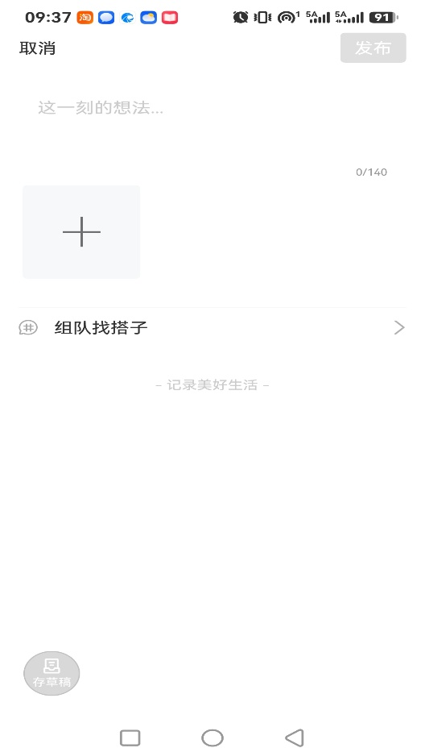
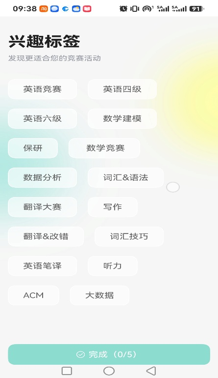
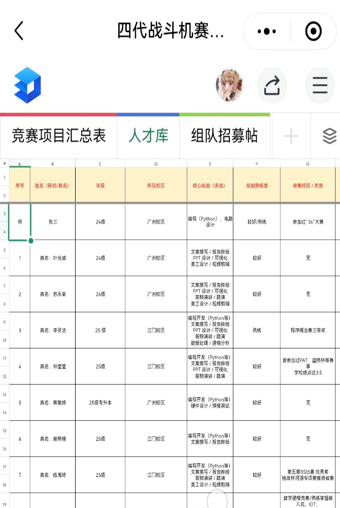
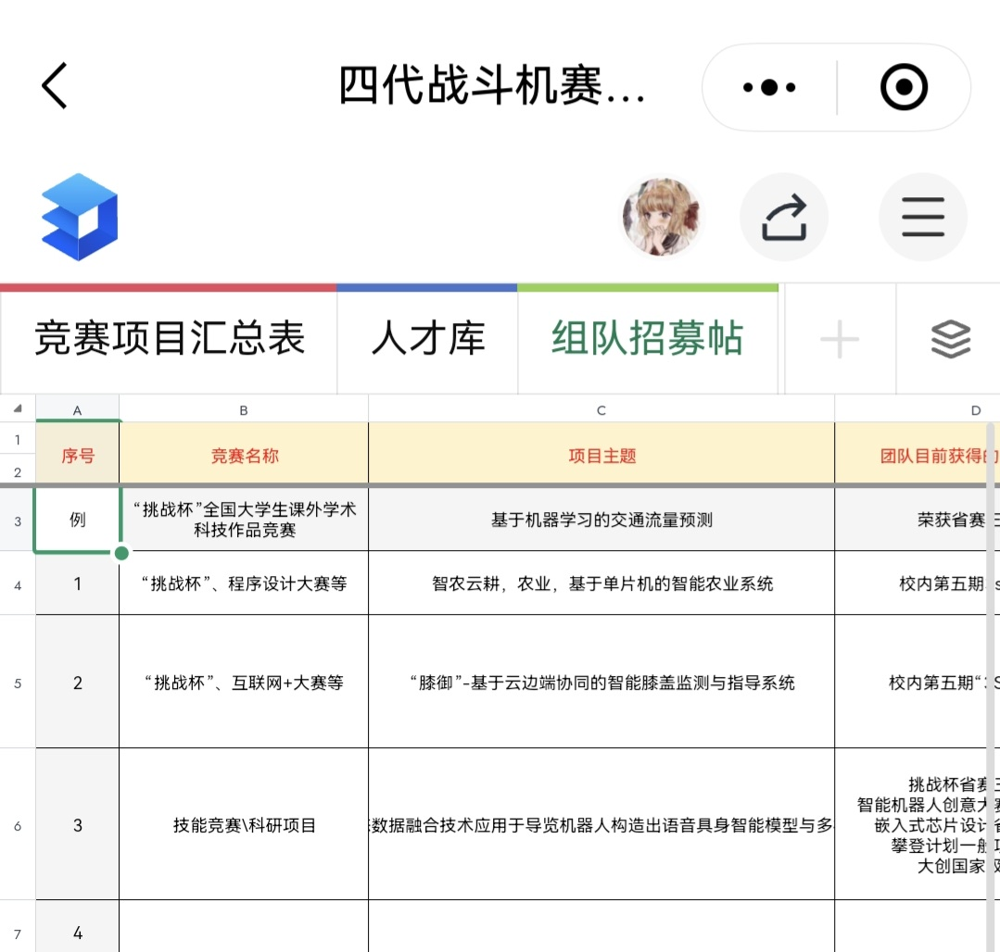
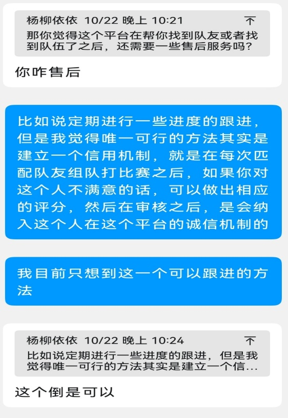
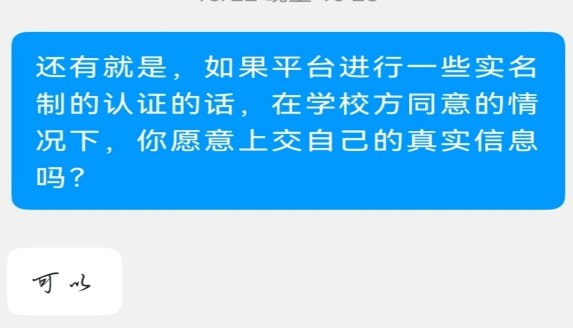

# 需求调研报告

搭子 Match—— 高校学生项目组队

### 第一部分：调研概述与目标用户界定

#### 1.1 调研背景与目的

调研背景：基于 “搭子 Match” 的选题，深入探究大学生在各类项目（竞赛、科研等）组队过程中的真实现状与诉求。

调研目的：明确目标群体特征；记录真实困扰；评估现有方案饱和度；了解用户对初步解决思路的接受度。

佐证声明：本报告所有数据及结论均来源于真实访谈及全网舆情挖掘，相关记录与截图详见文末【附录】。

#### 1.2 目标用户画像界定

角色 A：队长（招募者）：主动发起项目，极度看重队友的靠谱程度和执行能力。

角色 B：队员（求入者）：希望加入优质项目，极度害怕遇到 “不靠谱的队长” 或 “项目半路夭折”。

角色 C：平级搭子（共同目标驱动者）：有共同目标，通过技能互补以平级合作方式拼凑队伍。

#### 1.3 调研方法与样本说明

深度用户访谈：深度访谈 4-5 位代表性用户。

全网舆情挖掘：深入知乎、小红书、表白墙等公共平台收集舆情。

现有渠道体验：亲自体验现有组队方法、相关APP等组队流程。

### 第二部分：现有解决方案与市场饱和度分析

#### 2.1 现有主流组队方式盘点

通过对当前校园组队生态的深入调研，我总结出现有的四大主流渠道，且每个渠道都存在难以调和的痛点：

**熟人社交圈（班级群、寝室、社团内部）**

现状：靠人脉相互介绍或内部消化。

缺陷：熟人圈层合作本身存在一些社交问题，大量用户反馈熟人组队缺陷，其次虽然信任度高，但覆盖面极窄。完全无法满足跨专业寻找技能互补队友的需。

**校园公域墙与学生自建平台（表白墙、贴吧、校园频道、校园集市）**

现状：在公共信息流中发帖，等待别人评论或私信。

缺陷：信息极其杂乱。找对象、二手交易、找搭子混在一起，缺乏分类与检索，帖子极易被刷走或者沉底而不被看到。

**特定群聊与官方通知（比赛交流群、辅导员 / 老师在年级群代发）**

现状：在特定的比赛群刷屏 “缺人”，或辅导员转发招募通知后，同学直接去加负责人微信/或建一个新的群聊。

缺陷：麻烦，沟通低效且缺乏缓冲。群聊消息易被淹没，缺乏技能画像，难以匹配到合适的人选；直接加微信带来极大社交压力与筛选成本。

**泛社交平台（小红书、微博等大众社交媒体）**

现状：发布带关键词的帖子，面向全网捞人。

缺陷：缺乏信任背书与地理边界。范围太大，无法确认对方真实身份，极易遇到骗子或放鸽子。

#### 2.2 典型平台深度对标分析

在梳理完四大主流渠道的整体痛点后，我们进一步挑选了 5 个与校园组队高度相关的代表性平台逐一体验，从定位差异、现有能力与优点、存在短板、产品启示四个维度进行拆解，作为评估现有方案饱和度、推导产品设计的直接依据。

##### 2.2.1 赛氪

**和搭子 Match 的核心定位差异**

赛氪是赛事聚合、赛事报名服务平台，平台的核心目标是汇集各类学科竞赛、科创活动，为学生提供赛事浏览、在线报名、缴费、接收赛事通知的服务。

搭子 Match 的核心定位，是以帮助学生寻找技能匹配的队友为主线，赛事、课程大作业、科研项目、技能学习都属于组队的应用场景。

二者逻辑顺序完全相反：

赛氪：先选定比赛，再把已经商量好的队友在平台里绑定，完成报名

搭子 Match：先找到匹配合适的队友，再一起组队参与课程、竞赛、科研等项目。

**赛氪现有相关能力与优点**

平台内置赛事讨论区，用户可以发布组队招募帖子，帖子支持文字描述、简易标签、配图，学生可以写明参赛项目、需要的能力、个人参赛经历等信息。

用户主页支持完善身份与履历信息：填写学校、专业、联系电话，录入参赛经历、获奖成果，形成科创履历，方便他人了解参赛者基础情况。

具备标签推荐机制：根据用户选择的兴趣标签，向用户推送适配的赛事内容。

成熟的队伍邀请与名单锁定机制：队长创建队伍之后，可以通过手机号、邮箱搜索平台内用户定向发起入队邀请；也可以生成队伍二维码分享给队友，对方扫码、接受邀请后加入队伍，最终锁定完整队伍名单，用于赛事提交报名。

**存在的短板**

组队相关功能全部依附在单场赛事的报名流程之内，脱离该赛事就无法创建、管理队伍，不支持课程作业、科研训练、技能学习这类非赛事场景的组队。

招募讨论区属于平台附加板块，并非主推功能，发帖更新频率低、帖子回复与热度不足、活跃度差，很难依靠这个板块高效地找到陌生队友。

标签体系简陋，标签只是发帖时的附加点缀，没有做成标准化、分区的技能标签库；平台不会基于标签做多维度筛选、智能匹配推荐，用户只能手动浏览帖子，不能精准检索队友。

缺少校园分层隔离设计，不存在校内、同市、同省、全国的可见范围权限控制，缺少适配校园环境的信任保护机制。

没有完整的组队闭环：不存在招募申请审批流程、没有项目归档功能，也没有赛后互评、信用沉淀体系，无法积累队友的评价记录，难以判断队友是否靠谱。

**可供搭子 Match 借鉴的产品启示**

实名档案与科创履历的设计思路 借鉴它登记学校、专业、参赛获奖经历的档案模式，在搭子 Match 搭建学生技能画像；同时做优化升级，采用学校邮箱认证，在保证身份可信的前提下，更好地保护用户隐私。

队伍邀请、名单锁定的交互流程 吸收它两种组队邀请方式：定向搜索账号邀请、二维码扫码入队。既可以满足在平台匹配到合适人选之后，队长定向发出组队邀请，也适配线下本来就认识的伙伴，借助平台完成队伍确认、名单归档锁定的场景。

标准化标签优先、正文为辅的匹配方案（核心借鉴点） 赛氪的标签只是帖子的附加装饰，匹配依赖自由文本，识别准确度低。由此得到启发：搭子 Match 将技能、项目类型、需求方向等核心信息拆分为预设的分区标准化 Tag，匹配、检索、智能推荐以标签作为主体，帖子正文仅用来承载补充描述。队长发布招募、队员完善个人意向时优先勾选标签，用类似搜索引擎的方式筛选匹配，不依赖 AI 从大段文本提取关键词，匹配可控精准，同时降低 Demo 落地难度。

业务链路闭环的思想 赛氪将组队和赛事报名打通，减少流程割裂。本项目借鉴这个闭环思路，串联招募发布、申请审批、智能匹配、队伍锁定、项目归档、赛后互评，形成一条完整的组队全流程。

**总结**

赛氪的实名履历、标签、队伍邀请机制都有参考价值，但整套能力服务于赛事报名环节。本项目将这套机制独立重构，把找人匹配作为核心主线，拓展到课程、科研、兴趣学习等全部学生项目场景，补齐信任、匹配、权限管理相关能力。

**相关附图**

##### 2.2.2 广州学院四代战机赛事战队补给站

**和搭子 Match 的核心定位差异**

赛事战队补给站是轻量化校内专属竞赛组队工具，依托在线共享表格 + 问卷表单搭建，仅限广州软件学院本校在校学生使用，核心服务学科竞赛、创新创业、科研项目的校内组队需求。

相同点：二者都以帮助学生寻找技能匹配队友为核心主线。

区别：

它是单校封闭平台，仅服务本校，不支持跨校、跨城市范围选择

底层是表单 + 表格，依靠人工审核维护静态台账，没有自动化智能匹配引擎

场景只偏向竞赛、科研项目，没有针对课程大作业、兴趣技能学习组队的设计

搭子 Match 支持校内 / 同市 / 同省 / 全国分层可见，具备标签检索、智能推荐匹配能力，覆盖课程作业、竞赛、科研、兴趣学习多类组队场景

**平台现有相关能力与优点**

双角色入口：分为队长发布招募、队员入库两种问卷，角色分工清晰

三大台账：竞赛项目汇总表、人才库、招募公示区，人才库结构化记录技能、参赛经历，方便筛选队员

招募状态管理：招满后可提交表单下架招募信息，避免过期信息干扰

项目传承：归档往届优质项目，新人团队可以承接迭代

前置人工审核：提交信息经过工作人员审核之后才入库公示，保障信息真实

标准化技能选项：预设编程、硬件、文案、路演等技能标签，结构化采集信息，便于筛选

**存在的短板**

载体是金山文档 + 问卷星，属于人工维护的静态表格，没有智能匹配、消息推送，只能手动查找，匹配效率低

仅限单校内使用，覆盖范围有限

没有队伍创建、邀请入队、锁定队员的功能，匹配后的邀约、确认全部需要线下 QQ 沟通，组队流程没有闭环

缺少申请审批、信用互评体系，无法沉淀队友评价，只能依靠静态简历判断

**可供搭子 Match 借鉴的产品启示**

保留「我要招队友」「我要找队伍」双独立入口，两套填报流程，区分角色需求

使用标准化技能标签库，固定岗位选项，减少自由输入，方便筛选

增加招募状态管理，招满一键下架招募帖，避免无效咨询

采用信息前置审核机制，结合校邮实名核验，审核通过后信息对外展示，减少虚假招募

**总结**

该平台证明校内技能组队需求真实存在，双角色、招募状态管理、结构化人才库的设计思路很有参考价值；但它受限于表单台账的形态，缺少自动化匹配和完整组队闭环，且仅限单校使用，搭子 Match 可以在它的基础上拓展范围、补齐自动化匹配、队伍管理、互评能力，覆盖更多组队场景。

**相关附图**

##### 2.2.3 川一串

**和搭子 Match 的核心定位差异**

川一串是四川大学学生自主开发、依托本校邮箱实名的校内问卷匹配平台，主打价值观、兴趣维度的同频社交匹配，核心场景是交友、美食搭子、线下约伴。

相同点：二者都面向在校学生寻找搭档，采用校园邮箱实名认证、问卷画像 + 匹配推荐的模式，希望提升搭子匹配的可信度。

区别：

它以兴趣社交、约饭结伴为主，不面向竞赛、课程作业、科研项目组队

匹配是固定周期（每周批量推送），没有主动发布招募帖的信息流

仅限川大校内，不支持跨校分层范围选择

搭子 Match 主打技能导向项目组队，支持主动发布招募、随时检索人才，覆盖课程、竞赛、科研、兴趣多场景，可校内 / 同市 / 同省 / 全国分层开放

**平台现有相关能力与优点**

校邮实名准入：四川大学邮箱核验身份，限定用户为本校在校生，建立可信准入门槛

权重化画像匹配：问卷收集多维度画像标签，不同匹配维度设置权重占比，按照权重计算相似度做推荐

多元化画像控件：除单选多选外，使用横向滑块控件采集偏好程度，丰富画像颗粒度

隐私保护设计：公开页面自动拦截微信、手机号等联系方式，只有饭局报名成功后才互相开放联系方式，减少骚扰

多分区场景入口：主线价值观匹配之外，设置美食搭子、游戏搭子等独立板块，覆盖轻量化线下结伴需求

**存在的短板**

只有每周被动推送，不支持自主发布招人需求、主动检索搭子

匹配节奏固定，时效性弱，有紧急组队需求时不能快速找人

界面排版布局混杂，内容纵向堆叠在同一页面，新内容不独立分页跳转，信息层级模糊

文案 slogan 过多，装饰性文字繁杂，容易干扰用户

可点击按钮和普通文字区分度弱，交互边界不清晰用户难以识别可操作元素

**可供搭子 Match 借鉴的产品启示**

校园邮箱实名方案：沿用学校邮箱核验身份的可信机制，低成本保障用户身份真实，减少虚假信息

带权重的多维度匹配设计：给技能、空余时间、协作习惯等不同维度设置匹配权重，提升推荐贴合度

丰富问卷交互形式：除选项外，使用滑块组件采集偏好程度，细化用户画像

隐私隔离策略：对外公示信息隐藏私人联系方式，达成匹配意向之后再开放联络渠道

界面交互反面参考：避免大量装饰性文案，精简宣传标语；功能模块独立新开页面跳转，做好信息分层；强化按钮视觉边界，明确区分静态文字和可点击操作项

标签化采集优先：优先提供标准化标签选项，减少用户自由文本填写，既方便平台管理，也让匹配更加精准，同时保留少量自定义描述区域，满足发帖表达需求

适配学生项目的现实约束：学生自研项目算力、运维人力有限，可参考周期批量匹配方案，不强制做到实时秒级匹配，在产品说明中说明匹配调度周期

**总结**

川一串验证了 “校邮实名 + 权重化问卷画像匹配” 在校园搭子场景的可行性，隐私保护、多维度加权匹配的设计值得参考；但其底层是兴趣社交类匹配，不是项目组队工具，同时在页面架构、交互识别、信息分层上存在明显缺陷。搭子 Match 吸收它的实名、加权匹配、隐私方案，转向技能导向组队赛道，同时采用分页跳转、精简文案、标准化标签、清晰按钮交互的方案，规避它的界面短板。

**相关附图**

##### 2.2.4 北邮学校立项项目

**BUPT 组队星**

对标类型：校内科创组队小程序

共同点：面向竞赛、课程作业、科研组队、技能标签、招募发帖、队长审     批、匹配推荐

差异：仅限单校内使用，不支持分层跨校开放；缺少完整信用评价体系； 隐私管控弱，无联系方式隔离

**智搭 CampusLink**

对标类型：带大模型的校园组队平台

共同点：科创组队场景、技能画像、AI 推荐、双向撮合

差异：兴趣搭子和科创组队信息流混在一起；AI 仅用于推荐，没有项目 Agent；跨校不是重点；队伍权限、互评体系不完善

**补充备注：**

BUPT 组队星、智搭 CampusLink，是北邮雏雁计划（大创）的学生立项项目，属于校内申报课题，只是在北邮创新创业平台上有项目档案，没有对外开放。

##### 2.2.5 小红书、豆瓣、校园频道等

**小红书**

学生常以长图形式整理组队需求，写明项目内容、自身能力、项目进度、招募队友要求，搭配相关标签引流；感兴趣的同学在评论区留言简介或者直接留言 dd，后续全部依靠私信单独对接

优点：

传播范围广，可以跨校寻找队友

标签可以起到粗略分类匹配的作用

展示形式丰富直观

短板：

平台本身不是为组队设计，没有标准化信息模板、没有系统筛选与匹配功能

没有实名认证、信用记录

大量私信沟通，对接流程零散繁琐，沟通成本很高

信息流混杂无关内容，帖子很快下沉

**豆瓣**

相关板块大多以寻找学习督促搭子为主，学科竞赛、科创项目的组队帖数量很少，不是学生竞赛组队的主流渠道。

优点：氛围偏向长期学习陪伴

短板：科创组队需求供给不足，很难找到竞赛、大创、科研项目队友，匹配效率低，不适合本项目对标重点

**校内频道**

用户把组队文案提交给审核人员，审核通过后对外发布动态，发布形式和小红书发帖逻辑相近；流量基本局限本校学生。

优点：受众都是本校学生，信任度相对更高，圈层精准。

短板：

同样是发帖 + 私信私聊模式，没有结构化标签检索、状态管理

消息容易刷屏沉没，招募进度没法跟踪

依旧要逐个私聊沟通，对接麻烦

**合并总结**

这三类都属于用户自发的野生发帖撮合渠道，底层模式一致：人工发布招募信息、意向者留言、后续一对一私聊对接。共性痛点是缺少标准化的招募表单、系统匹配、人员筛选、队伍管理和信用机制；豆瓣赛道不匹配，小红书胜在跨校流量，表白墙胜在校内可信，但三者都解决不了逐个私聊、对接繁琐的问题，这正是搭子 Match 要解决的地方。

**相关附图**

#### 2.3 市场饱和度分析结论

结论：现有组队市场远未饱和，缺乏真正做这件事情的平台，存在严重的 “信息错配” 与 “信任断层”。缺乏能实现信息精准过滤且提供信任背书的标准化工具。

### 第三部分：用户真实痛点场景与舆情原声呈现

#### 3.1 深度访谈中用户陈述的真实困扰

（注：真实还原用户吐槽）

关于找人的过程

“每次在竞赛大群里问有没有团队缺人，一般都是+1跟发，很少有人真正来私聊，上次好不容易等到一个来问的人，招人要求，想法也不一样就不了了之了。”

我之前想打竞赛去校园频道捞过人，发了个帖子，很快就沉底了，也没人来问我，后面就没管了。”

关于信任和踩坑

之前组队招过一些人，有些靠谱，有些也不太行，之前我遇到一个，说自己会什么什么，结果根本不会，又不靠谱，后面又重新找人。

“其实之前病急乱投医去小红书发过帖子，真正想组队的每两个，全是发生涯规划，考研保研啥的，有人来发私信很高兴，一看又是推销的。”

关于沟通的尴尬

“上次辅导员发了一个团队找人，说想深入了解的去加队长微信，我鼓起勇气发了申请，结果应该是没看到还是咋回事一直没通过。”

“我其实有点社恐，我加过一些·竞赛群，但是没人说话，我也不好意思在群里问有没有人和我组队，跟着+1是我的极限了。”

关于管理和后续

“上个月我们队伍找人，去校园频道发了帖子，结果人早就招满了后面还有源源不断的人来加我问我，为了礼貌还是一个一个回复别人，加了一堆不知名好友又不太好删除。“

“之前看到一个比较合适的发帖找人，结果上课退出了页面后面咋翻找也没找到。”

#### 3.2 全网相关内容舆情挖掘

情绪一：吐槽与避雷（防坑）

小红书上大量 “避雷！千万别跟这种人组队打比赛”“大作业遇到极品划水怪” 的高赞帖。最怕的不是能力不行，而是答应了又消失、混奖项的人。知乎上大量教人找队友的整理帖。

情绪二：焦虑与心累

吐槽 “找个靠谱的队友，合适的团队好难”。

不知道有什么途径能找到团队，队友，希望大家教教。

情绪三：社交恐惧

找人组队好麻烦，找队友的每一步对社交恐惧症来说都很艰难，好不容易鼓起勇气来最后也没找到，更恐惧了。

#### 3.3 假设性概念测试与态度反馈（方案试探）

关于 “实名认证” 的测试

受访者 A：“只要别让我传身份证就行。如果能用学号或者校园邮箱验证一下，我还是愿意的。遇到骗子还能知道是哪个学校的。”

关于 “互评与举报” 的测试

受访者 B：“干活积极的就应该好评，划水的就该打低分。不过平台还是要审核一下，如果恶意差评骂人，你们得能删掉。“

### 第四部分：调研结论与局限性说明

#### 4.1 调研结论

痛点高频且真实：组队痛点是高校学生在学习和竞赛场景中普遍面临的硬伤，市场体量巨大。

现有工具亟待升级：依赖 “校园频道”、“微信群” 的野路子时代急需改变，学生渴望有边界感和效率的标准化工具。

用户接受度较高：用户对建立 “实名信用机制” 和 “线上信息库” 抱有极高期待。

下一步动作：基于上述调研得出的真实痛点与现象，我们将正式提炼出 9 大核心需求点，并据此推导具体的解决方案（Proposal）。

#### 4.2 调研局限性说明

深度访谈样本量为 5 人，可能无法覆盖所有极端用户场景。

调研侧重于定性研究，未来产品立项阶段，将通过大规模问卷进行定量验证。

##### 【附录】

附录一：访谈记录（聊天记录等核心要点整理）部分

附录二：全网舆情截图汇总（小红书 / 知乎 等）部分
